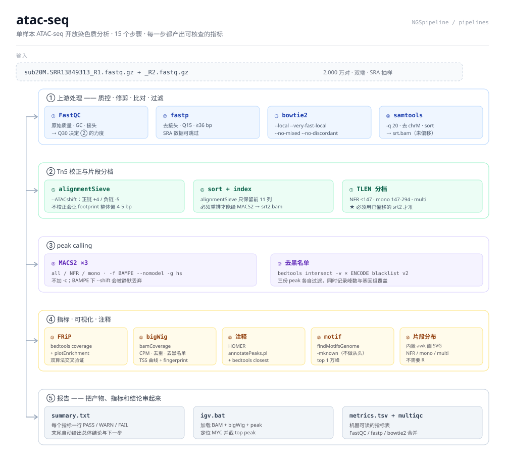

# ATAC-seq 全流程：Huh7.5 (HCV) 双端 FASTQ → 开放染色质图谱

从一份原始双端 FASTQ 走到 peak、motif 和 IGV 截图，每一步都落一个**可检查的产物**和一个**可判断对错的指标**。

| | |
|---|---|
| 样本 | `SRR13849313` — Huh7.5_HCV_ATAC（HCV 感染的 Huh7.5 细胞） |
| 数据 | 20 M 双端 reads 抽样，Illumina HiSeq 4000 |
| 参考 | hg38 / GENCODE v43 / ENCODE blacklist v2 |
| 形态 | 一个 **bioinformatics tool project**：`bin/` 入口 + `src/` 模块 + `config/` 配置 + `deploy/` 装依赖 + `reference/` `extratools/` 放数据 |
| 入口 | `bin/atac -1 R1.fastq.gz -2 R2.fastq.gz -t 20` |



---

## 一、这是什么项目

不是一个几百行的脚本，是一个**能装、能跑、能维护**的工具项目。五个目录各管一件事：

```
bin/          入口：只做参数解析 + 阶段调度，业务逻辑一行都不写
src/          业务模块：一个阶段一个文件，文件名带序号保证加载顺序
src/py/       解析 / 计算模块：fastp JSON、TLEN 分箱、FRiP、TSS、报告
config/       默认配置：路径、线程、阈值、命令选项
deploy/       依赖安装：软件体检 + 参考数据下载 + 外部工具
reference/    参考数据（不进 git）：基因组、索引、GTF、黑名单
extratools/   外部工具（不进 git）：HOMER、IGV、自己编译的二进制
env/          conda 环境定义
tests/        冒烟测试 + 单元测试（都不需要生信工具）
```

这样分的三个实际好处：

1. **加一步不用改别处** —— 在 `src/` 里加一个 `stage_xxx()` 文件，在 `bin/atac` 的 `run_pipeline` 里加一行，在 `20_context.sh` 的 `ALL_STAGES` 里登记。`config/` 和 `deploy/` 不用动。
2. **换机器只跑 deploy** —— 路径全部从 `reference/` `extratools/` 自动探测，`deploy/deploy.sh` 装完就能跑，不需要改任何配置文件。
3. **每一步可单独重跑** —— `--stages peaks,frip --force` 只重跑指定阶段，靠 `.status/*.done` 标记断点续跑。

---

## 二、快速开始

```bash
# 1. 软件体检：本机已经装了什么、还缺什么（不改动任何东西）
bash deploy/deploy.sh doctor

# 2. 只补装缺失的软件（已有的不重装，全部复用）
bash deploy/deploy.sh env
conda activate atac

# 3. 下参考数据（约 7 G；已有参考数据就跳过，见 reference/README.md）
bash deploy/deploy.sh genome bt2 annotation blacklist

# 4. ⑫⑬ 要用 HOMER，⑭ 要用 ATACseqQC，⑮ 要用 IGV —— 都按需装
bash deploy/deploy.sh homer atacqc igv

# 5. 体检（30 秒，避免跑到第 8 步才发现参考路径错）
bin/atac -1 raw/R1.fastq.gz -2 raw/R2.fastq.gz --check

# 6. 先看要跑什么
bin/atac -1 raw/R1.fastq.gz -2 raw/R2.fastq.gz --dry-run

# 7. 开跑（建议挂 tmux）
bin/atac -1 raw/sub20M.SRR13849313_1.fastq.gz \
         -2 raw/sub20M.SRR13849313_2.fastq.gz -t 20
```

常用参数：

```bash
bin/atac ... --list-stages            # 列出 13 个阶段及产物
bin/atac ... --stages peaks,frip      # 只跑指定阶段
bin/atac ... --stages peaks --force   # 强制重跑（忽略完成标记）
bin/atac ... --dry-run                # 只打印命令，不执行
bin/atac ... -o /data/results         # 换输出目录
bin/atac ... -s MySample              # 覆盖样本名
bin/atac ... --mapq 30 --qvalue 0.01  # 覆盖阈值
bin/atac ... --keep-tmp               # 保留中间 BAM
```

断了就重跑同一条命令：已完成的阶段会自动跳过。

### 已有参考数据、不想重下

```bash
# 软链接进来（不占额外空间，自动探测能认出来）
ln -s /public/storage/shaojf/Course/NGS/Reference/hg38.fa reference/genome/hg38.fa
ln -s /public/workspace/shaojf/Course/NGS/wkdir4labs/lab9/refs/bt2 reference/genome/bt2

# 或者命令行直接指
bin/atac ... -g /path/to/hg38.fa --bt2 /path/to/bt2/hg38
```

---

## 三、15 步：产物 · 指标 · 判读

| # | 步骤 | 模块 | 关键命令 | 产物 | 关键指标 | 判读标准 |
|---|---|---|---|---|---|---|
| ① | FastQC 原始 | `30_stage_qc` | `fastqc -t 4` | `01_fastqc/*.html` | reads 数、GC | 20 M pairs；GC 38–42% |
| ② | fastp | `31_stage_trim` | `--detect_adapter_for_pe -q 15 -u 40 -l 30` | `02_fastp/*.clean_*.fq.gz`、`.html`、`.json` | 保留率、Q30、重复率 | 保留率 > 95%；Q30 > 85% |
| ③ | bowtie2 | `32_stage_align` | `--local --very-fast-local -X 2000` | `03_map/*.sam`、`.bowtie2.txt` | 总体比对率、chrM 占比 | 比对率 > 95%；chrM < 5% 优秀 |
| ④ | 过滤排序 | `33_stage_bam` | `samtools view -q 20 -e 'rname!="chrM"'` | `04_bam/*.srt.bam(.bai)`、flagstat、stats | 保留 reads、配对率、重复率、插入长度 | 配对率 > 80%；重复率 < 30% |
| ⑤ | Tn5 校正 | `33_stage_bam` | `alignmentSieve --ATACshift` | `04_bam/*.shift.bam` | 是否 +4/−5 | — |
| ⑥ | 重排 | `33_stage_bam` | `samtools sort + index` | `04_bam/*.srt2.bam` | 记录字段数 | 必须 = 11 |
| ⑦ | 片段分箱 | `34_stage_frag` | `\|TLEN\|` 分三档 | `05_fragbin/*.bam`、`fragsize_dist.png` | NFR / mono / poly 占比 | NFR > 30% |
| ⑧ | MACS2 | `40_stage_peaks` | `-f BAMPE --nomodel -g hs -q 0.05` | `06_peaks/*_peaks.narrowPeak` | peak 数 × 3 路线 | 2 万–12 万 |
| ⑨ | 黑名单 | `40_stage_peaks` | `bedtools intersect -v` | `06_peaks/*.filtered.narrowPeak` | 剔除比例 | < 1% |
| ⑩ | FRiP | `41_stage_frip` | samtools `-L` ＋ bedtools `intersect` | `07_frip/<sample>/*.frip.tsv`、`plotFingerprint.png` | FRiP、两算法差值 | FRiP > 0.20；差值 < 0.02 |
| ⑪ | coverage | `42_stage_coverage` | `bamCoverage` ＋ `computeMatrix` | `08_bigwig/*.bw`、`09_tss/*` | TSS 富集倍数 | > 6（ENCODE） |
| ⑫ | 注释 | `50_stage_annot` | `annotatePeaks.pl -annStats` | `10_annot/all/*` | promoter / intron / distal 比例 | 见决策 6 |
| ⑬ | motif | `51_stage_motif` | `findMotifsGenome.pl -mknown` | `11_motif/*/knownResults.txt`、`top_motifs.tsv` | 最强 motif 及 fold | CTCF/NFY/SP1/ETS 靠前 |
| ⑭ | ATACseqQC | `52_stage_atacqc` | `fragSizeDist` / `TSSEscore` | `12_atacqc/*.pdf`、`.tsv` | TSSE、片段中位数 | TSSE > 6 |
| ⑮ | IGV | `53_stage_igv` | batch `snapshot` | `13_igv/*.MYC.png`、`.igv_batch.txt` | — | MYC 区有清晰 peak |
| ★ | 汇总 | `60_stage_report` | MultiQC + 自建报告 | `99_report/report.html`、`summary.tsv` | 全部指标 + 判读 | — |

所有指标都写成同一个五列格式（`step / key / value / unit / benchmark`），落在 `results/metrics/*.tsv`，由 `60_stage_report` 统一按阈值判 PASS/WARN。

`results/99_report/report.html` 是最终交付物：它把上面每一行的数值、阈值、结论排在一起，图直接嵌在 HTML 里，单文件可转发。最后一段是**三指标合看**——TSS 富集 / FRiP / 片段周期并排判读，这是全篇唯一一处敢说「这批数据能不能用」的地方。

---

## 四、目录结构

```
.
├── bin/atac                  # 入口：加载模块 → 解析参数 → 按阶段调度
├── src/
│   ├── 00_common.sh          # log / run / need / 阶段标记 / 指标落盘
│   ├── 10_cli.sh             # usage + parse_cli
│   ├── 20_context.sh         # 校验、派生路径、建目录、PATH、日志
│   ├── 70_preflight.sh       # 工具与参考数据体检
│   ├── 30_stage_qc.sh        # ①
│   ├── 31_stage_trim.sh      # ②
│   ├── 32_stage_align.sh     # ③
│   ├── 33_stage_bam.sh       # ④⑤⑥
│   ├── 34_stage_frag.sh      # ⑦
│   ├── 40_stage_peaks.sh     # ⑧⑨
│   ├── 41_stage_frip.sh      # ⑩
│   ├── 42_stage_coverage.sh  # ⑪
│   ├── 50_stage_annot.sh     # ⑫
│   ├── 51_stage_motif.sh     # ⑬
│   ├── 52_stage_atacqc.sh    # ⑭
│   ├── 53_stage_igv.sh       # ⑮
│   ├── 60_stage_report.sh    # ★
│   └── py/                   # 解析 / 计算（Python + R）
├── config/
│   ├── atac.conf             # 主入口的默认配置（唯一配置源）
│   ├── config.yaml           # Snakemake 层配置（只给 workflow/ 用）
│   └── organisms/hg38.yaml   # Snakemake 层的基因组路径
├── deploy/
│   ├── deploy.sh             # 总入口：doctor / status / env / genome / bt2 / …
│   ├── lib.sh                # 下载、空间检查、表格输出
│   ├── 00_doctor.sh          # 软件体检
│   ├── 10_ref_genome.sh      # 基因组 fasta + bowtie2 索引
│   ├── 15_annotation.sh      # GENCODE GTF
│   ├── 20_blacklist.sh       # ENCODE blacklist v2
│   ├── 30_homer.sh           # HOMER + hg38
│   ├── 40_atacqc.sh          # ATACseqQC
│   └── 50_igv.sh             # IGV
├── reference/                # 参考数据（不进 git）
├── extratools/               # 外部工具（不进 git）
├── env/environment.yml       # conda 依赖
├── tests/
│   ├── smoke_test.sh         # 51 项：脚手架 / 参数 / dry-run / 阶段跳过
│   └── run_tests.sh          # 15 项：解析 / 计算 / 阈值判读 / 报告
├── workflow/                 # 可选：Snakemake 调度层（见第九节）
├── Makefile                  # make doctor / status / deploy / test / lint
├── RUNBOOK.md                # 排障手册
└── results/                  # 运行后生成，01_… → 99_report
```

两套配置互不干扰：`config/atac.conf` 管 `bin/atac`，`config/config.yaml` + `config/organisms/`
只管 `workflow/` 的 Snakemake 调度，两者产出的 `results/` 目录结构完全一致。

---

## 五、参考运行结果（20 线程实测）

> 下面是这套流程在课程服务器上跑同一份数据得到的数，用来对照你自己的运行结果。

| 指标 | 数值 | 说明 |
|---|---|---|
| 原始 reads | 20,000,000 pairs | SRA 20 M 抽样 |
| chrM 片段 | 5,468,135（**27.3%**） | 偏高，必须在 ④ 去掉 |
| 比对 + 过滤后 | 24,858,228 reads | 去 chrM、MAPQ≥20 之后 |
| peak 数（全部片段） | 74,420 | 去黑名单后 74,134（仅剔 0.38%） |
| peak 数（NFR） | 102,815 | NFR 信号更"碎"，peak 更多更窄 |
| peak 数（单核小体） | 47,495 | 更接近核小体占位 |
| FRiP（全部片段） | **0.5388** | samtools 与 bedtools 两算法一致 |
| 运行耗时 | 比对 2 m 33 s（200 线程）／motif 2 h（全量 peak） | — |

chrM 27.3% 这个数值得单独说一句：ATAC 建库时线粒体基因组会被 Tn5 一起打碎，Huh7.5 这类肝癌细胞系线粒体多，占比高很常见。**不去掉 chrM 直接 call peak，peak 会大量堆在 mtDNA 上**，FRiP 也会被稀释。

---

## 六、几个关键设计决策

**1. 为什么 `alignmentSieve` 之后必须重排**
`alignmentSieve` 输出只保留前 11 个字段（SAM 的 tag 全丢），并且坐标被 +4/−5 挪动后**顺序不再有序**。不重排直接 `samtools index` 会报错或产生错误的区间索引。所以 ⑥ 是必需的，不是多余的保险。`33_stage_bam.sh` 最后会数一遍字段数，不等于 11 直接报错。

**2. 为什么 TLEN 分档要用已偏移的 srt2.bam**
147 bp 这个阈值是"缠绕一个核小体"的长度。偏移把每条 read 的 5' 端挪了 4–5 bp，两条 mate 各挪一次，片段长度的判定窗口就整体错位约 9 bp。用未偏移的 srt.bam 分档，NFR 档会系统性偏少。

**3. 为什么 MACS2 不传 `--shift / --extsize`**
`-f BAMPE` 模式下 MACS2 用 reads 的真实跨度定义片段，源码里会把 `shift` 强制归零（`OptValidator.py`）。传了不报错，但**静默无效**——这种"看起来调了参数其实没生效"的坑，比报错更难查。`tests/smoke_test.sh` 里有一条断言专门守着它。

**4. 为什么 FRiP 要算两遍**
`samtools view -c -L` 走 htslib 的区间索引，`bedtools bamtobed | intersect` 走完全不同的区间求交实现。两个数一致，说明 BED 与 BAM 的染色体命名、坐标体系、排序状态都对得上。差超过 0.02 就该停下来查文件，而不是解释生物学。

**5. 为什么多核小体档不 call peak**
跨 2 个以上核小体的片段，两端落在两个不同的开放区，peak 边界会被拉糊。这一档的用途是看**核小体周期性**（⑦⑭ 的片段分布图），不是定位开放区。所以 ⑧ 只跑「全部片段 / NFR / 单核小体」三条路线。

**6. 为什么 promoter 占比不能太高**
ATAC 的 peak 应该以 distal intergenic 和 intron 为主（通常合计 50–70%），promoter 20–35%。如果 promoter 超过 60%，要么是 TSS 附近高信号把 peak 全吸过去了，要么是细胞状态极度活跃——两种情况都需要回头看 TSS 富集图和片段分布，而不是直接下结论。

**7. 为什么配置里用数组而不是字符串**
`FASTP_OPTS=(--detect_adapter_for_pe -q 15 -u 40 -l 30)` 展开时每个元素是一个独立参数；写成字符串再 `$OPTS` 会依赖 `IFS`，一旦脚本里设了 `IFS=$'\n\t'` 就会把 `-q 15` 拆错。数组不受 `IFS` 影响。

---

## 七、和课件流程的三处差异

| 课件 | 这里 | 原因 |
|---|---|---|
| ⑦ 三份 BAM 全做 MACS2 | 只做 全部 / NFR / 单核小体 | 多核小体片段跨多个开放区，peak 边界不可靠（见决策 5） |
| ⑬ motif 用全部 peak | 取 q 值 top 10,000 | 全量 7 万 peak 跑 known motif 要 2 小时，top 1 万信号最强、结论不变 |
| ⑮ IGV 手动截图 | batch 脚本 `snapshot` | 可复现、可进 CI；无图形环境时自动降级到 pyGenomeTracks |

---

## 八、和课程「作业思路」的对应

课件里那几句话是判分点，也是答辩会被追问的地方。逐条对到代码：

| 课件里的说法 | 落点 | 证据在哪 |
|---|---|---|
| 记住每一步的**产出物**；问「你的 peak 怎么来的」就按这条链回答 | 第三节的 15 行表，每行都有「产物」列；`results/01_…/13_…` 一目录一类产物 | `ls results/` |
| 比对后**必须**做 Tn5 偏移校正（+4/−5），否则 peak 整体偏约 9 bp | ⑤ `alignmentSieve --ATACshift`；⑥ 强制重排并校验字段数 | 决策 1 |
| peak caller 用 Genrich 或 MACS2，**别混用** | 全程只用 MACS2，三条路线同一个 caller、同一套参数 | `40_stage_peaks.sh` |
| QC **三指标缺一不可**：TSS enrichment（>6）/ FRiP / insert size 核小体周期 | ⑪ TSS 富集、⑩ FRiP、⑦ 片段分箱；报告末尾「三指标合看」 | `report.html` 结论段 |
| 任何单一 QC 图只是「体检一项」，结论要**三张图合看** | 报告最后一段把三项并排判读，达标项不足两项就直接说「别做下游」 | `src/py/make_report.py` |
| 最常踩的坑：**线粒体污染**、Tn5 偏好未校正 | ④ `samtools view -e 'rname != "chrM"'`（本样本 27.3%，不去就废）；⑤ ATACshift | 决策 1 |
| IGV 里先确认**归一化方式**再比幅度 | ⑮ 图注写明 `bamCoverage CPM`，只画单样本不做跨样本幅度比较 | `13_igv/*.png` |
| 主线：生物学问题 → 建库策略 → 比对与定量 → 质控 → 生物学解读 | 报告结论按这个顺序排：先 chrM/比对率（数据干不干净）→ 片段/FRiP/TSS（建库成不成功）→ peak/注释/motif（生物学） | `report.html` |

**三处刻意没做**，都写进报告里，免得被当成遗漏：

1. **差异可及性（DiffBind）** —— 只有单样本，没有重复也没有对照。硬做出来的是假差异，所以不做；`results/06_peaks/` 里的 narrowPeak 已经是可以直接喂给 DiffBind 的格式。
2. **footprinting（TOBIAS）** —— 不在 15 步链路里，而且需要生物学重复才稳。留作扩展。
3. **Genrich** —— 课件说 Genrich 和 MACS2 二选一，这里选 MACS2：`-f BAMPE` 直接用真实片段跨度，和 ⑦ 的 TLEN 分箱口径一致；换 Genrich 反而要重新解释一遍 `-j/-y` 参数。

---

## 九、为什么是这种结构：三种方案对比

你问过「模块化项目、Snakemake、snakePipes 三个哪个更好」。先说一个容易混的点：**snakePipes 本身就是 Snakemake 工作流**，所以「参考 snakePipes」和「用 Snakemake」不是两个选项，是同一个方向。真正的选择是：**要不要把调度器和业务逻辑绑在一起**。

| | 模块化项目（本仓库主入口） | Snakemake（`workflow/`） | 直接抄 snakePipes |
|---|---|---|---|
| 调度 | 按阶段顺序 + `.status` 断点续跑 | 按文件依赖自动推导，改一条 rule 只重跑下游 | 同左 |
| 并行 | 单阶段内部多线程 | 不同 rule 之间也能并行（三条 FRiP 同时算） | 同左 |
| 依赖安装 | **`deploy/` 一站式解决**：软件体检 + 参考数据 + 外部工具 | 只管调度，装环境要另写 | conda + 手工 |
| 可读性 | 一个阶段一个文件，读 `33_stage_bam.sh` 就懂 ④⑤⑥ | 规则分散在 include 里，追一个产物要跨文件 | 3 万行 Python 胶水 |
| 上手成本 | 会 bash 就能改 | 要懂 wildcard / DAG / `--use-conda` | 要懂它整套 organism 配置 |
| 适合 | 单样本、教学交付、要能讲清每一步 | 多样本批量、频繁改参数重跑 | 全实验室共用、多物种多流程 |

**我的判断：这个作业用模块化项目更合适，理由是三条。**

1. **你的作业要求里有"装依赖"这一项，而 Snakemake 不管这个。** 参考数据 7 G、HOMER 要 `configureHomer.pl -install hg38`、IGV 是 GUI 程序要下 zip、ATACseqQC 要 Bioconductor——这些没有一条能写进 Snakefile。`deploy/` 才是这个项目里工作量最大、也最容易被问「换台机器怎么跑」的部分。
2. **单样本不需要 DAG 调度。** Snakemake 的价值在"20 个样本、改一个参数只重跑受影响的 3 个 job"。一个样本 15 步，顺序跑就是最优解，DAG 只是多一层间接。
3. **答辩要讲清楚每一步在做什么。** `bin/atac` 跑完，`results/01_…/13_…` 一路排下来，对着目录就能讲完整条链；Snakemake 的产物路径是规则拼出来的，讲的时候要先解释一遍 wildcard。

**那 `workflow/` 为什么还留着？** 因为它不是重复实现，是同一批模块的另一种调度方式：`workflow/rules/*.smk` 里所有实际计算都调 `src/py/` 的脚本，没有第二份算法。等哪天要做 20 个样本的批量，`snakemake -j 20` 就能把三条 FRiP、三条 motif 并行起来，比顺序跑快 2–3 倍。留着它成本很低（`tests/smk_dryrun.sh` 守着它别坏），收益在批量时才兑现。

**什么时候该换成纯 Snakemake？** 当你开始有"样本表"这个东西——比如 `samples.tsv` 里 30 行，每行一对 FASTQ。那时候 `SAMPLES` 从配置里读、`expand()` 出 30×N 个 job，才是 Snakemake 该干的活。现在硬上，等于用一个调度框架解决一个不需要调度的问题。

---

## 十、常见问题

**`samtools sort` 报 "Too many open files"**
`ulimit -n 65536`，或把 `-t` 降到 8–10。

**HOMER 报 `Could not find genome hg38`**
`bash deploy/deploy.sh homer`（它会跑 `configureHomer.pl -install hg38`）。装完 `bash deploy/deploy.sh status` 应该显示 `HOMER + hg38  OK`。

**⑭ 被跳过，日志说"R 里没有 ATACseqQC"**
`bash deploy/deploy.sh atacqc`。这一步失败不影响主链——⑦⑪ 已经给出同口径的片段分布和 TSS 富集数值。

**⑮ 报 `no display`**
装 `xvfb-run`（`conda install -c conda-forge xorg-xvfb`），流程会自动用 `xvfb-run -a` 包一层；或者 `bash deploy/deploy.sh igv` 装 pyGenomeTracks 走另一条路。

**磁盘不够**
`KEEP_SAM=0 bin/atac -1 ... -2 ...` 不落 SAM（③④ 合并成一条管道），省约 20 G；
跑完 `results/.tmp` 会自动清掉，要留就加 `--keep-tmp`。

**换物种**
复制 `config/atac.conf` 改 `HOMER_GENOME` / `MACS2_GSIZE`，把新基因组放进 `reference/genome/`，`bin/atac -C my.conf` 加载。代码一行不用改。

---

## 十一、参考

- [snakePipes](https://snakepipes.readthedocs.io/en/stable/) — `workflow/` 的目录/配置组织方式来源
- [ENCODE ATAC-seq pipeline](https://github.com/ENCODE-DCC/atac-seq-pipeline) — 阈值与判读标准（TSS enrichment > 6、FRiP）
- [ATACseqQC](https://bioconductor.org/packages/ATACseqQC/) — 片段分布与 TSSE 定义
- [deepTools](https://deeptools.readthedocs.io/) — alignmentSieve / computeMatrix / plotEnrichment
- [HOMER](http://homer.ucsd.edu/homer/) — peak 注释与 motif 富集
